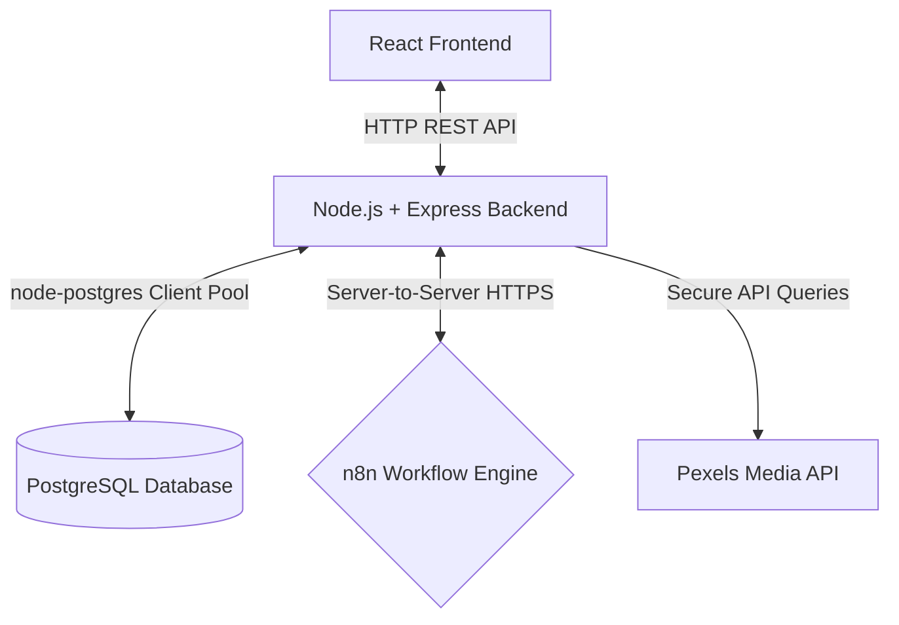
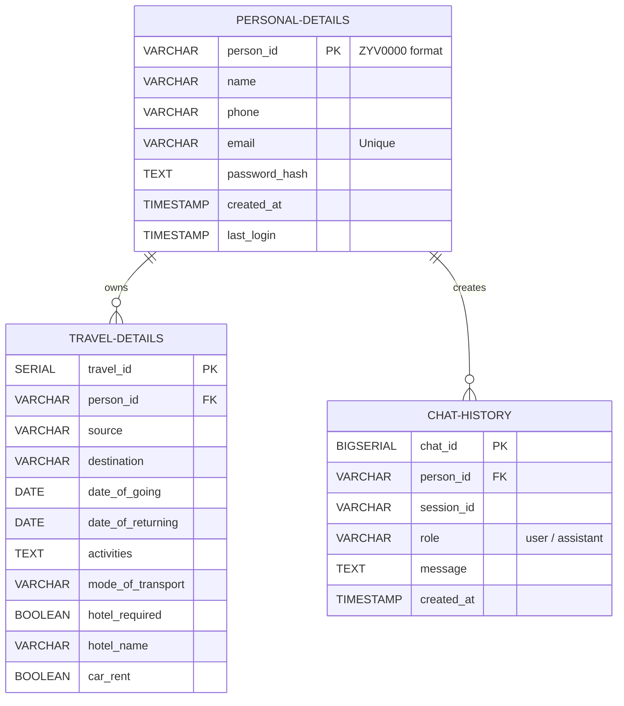

# Zyvox AI - Backend Architecture & Usage Documentation

This document explains the usage, architecture, and operational flow of the backend in the **Zyvox AI** ecosystem, detailings how it bridges the React frontend, PostgreSQL database, and n8n agent workflow.

---

## 1. Architectural Overview

Zyvox AI utilizes a decoupled architecture where the user interface, backend service, and automation agent run independently.

### Core Technologies
* **Runtime**: Node.js
* **Framework**: Express (ES Modules enabled via `"type": "module"`)
* **Database Driver**: `pg` (node-postgres) Pool connection manager
* **Security & Auth**: `bcrypt` for password hashing
* **Integrations**: `fetch` with `AbortController` for microservice communications (n8n & Pexels)

---

## 2. Core Operational Duties of the Backend

The backend acts as the secure coordinator for the application, handling:

### A. Security & API Secret Management
* **CORS & Interstitial Bypass**: Prevents client browser CORS errors when reaching out to external tunnels (like `zrok` or `ngrok`).
* **API Key Protection**: Stores Pexels and other third-party API keys securely in the server `.env` file, preventing leakage to public client applications.

### B. User Access Control & Auth Flow
* Manages user registration (`/api/auth/signup`) and signs password hashes.
* Generates structured, unique customer IDs sequentially (e.g. `ZYV0001`, `ZYV0002`).
* Verifies credentials (`/api/auth/login`) and updates metadata such as `last_login` timestamps.

### C. Chat Proxying & Logging Flow
The chat route `/api/chat/send` coordinates the chat lifecycle:
1. **Log User Message**: The incoming chat request is saved to `chat_history` mapped to the user's `person_id`.
2. **Tunnel Skip Headers**: Sends the payload to n8n Webhook URL with specific headers like `skip_zrok_interstitial` to prevent connection stalls.
3. **Parse Engine Responses**: Resolves diverse response keys returned by n8n (e.g. `reply`, `output`, `text`, `message`) into a standard output object.
4. **Determine Response Type**: Inspects the payload to distinguish between standard questions, rough drafts (`plan_rough`), or final itineraries (`plan_final`).
5. **Log Assistant Reply**: Saves the standardized bot response to the database before replying to the frontend.

### D. Dynamic Agent Status Checks
* Periodically queried by the frontend `/api/chat/status` to confirm the n8n tunnel is responsive.
* Strips the path from the webhook URL and performs a low-overhead, 5-second timeout check on the base URL to verify if the server environment is healthy.

---

## 3. Database Schema

The backend automatically bootstraps the database on launch. The schema is organized into three tables:

---

## 4. API Endpoints Map

### Authentication (`/api/auth`)
* `POST /signup` - Registers a user, hashes password, saves record.
* `POST /login` - Compares passwords, updates login timestamp.
* `GET /check-email?email=...` - Validates if email already exists during client-side registration.

### Travel Itinerary Manager (`/api/travel`)
* `POST /` - Creates a new structured itinerary.
* `GET /user/:personId` - Fetches all itineraries saved by a specific user.
* `GET /:travelId` - Fetches a single itinerary details.
* `PUT /:travelId` - Updates a travel plan.
* `DELETE /:travelId` - Deletes a travel plan.

### Chat & Status Operations (`/api/chat`)
* `POST /` - Manually logs an arbitrary message block.
* `POST /send` - Proxies chat prompt to n8n, processes it, and returns the response.
* `GET /history` - Retrieves full message threads for a user/session.
* `GET /status` - Runs a server-side health check against the n8n webhook base domain.

### Pexels Integration Proxy (`/api/pexels`)
* `GET /media?query=...` - Queries high-resolution images and background videos from Pexels API.
